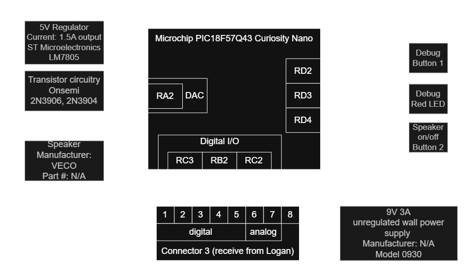

## Overview
This block diagram is an overview of my individual subsystem, the components used, and electrical connections. My subsystem will use the PIC18F57Q43 Curiosity Nano to control the speaker circuitry which includes two transistors, debug red LED, 5V regulator, and speaker on/off button. My connector will receive a signal from Logan Maelstrom's pin 4 (RF1) into my connector 3 pin 4 (RB2). 

## Product Requirements
The 9V 3A power supply provides the power for my subsystem. The 5V regulator converts the 9V input into a 5V output to my board, which meets the team's voltage requirement. The PIC18F57Q43 Nano microcontroller, processes the signal coming from Logan's board that activates my speaker. The Digital to Analog Converter(DAC) listed in my block diagram generates and analog signal that the speaker uses to produce the sound. The transistor circuitry amplifies the current needed for the speaker to alert the user. The speaker produces the alert if drowsiness is detected. The debug button lets my subsystem be tested without needed Logan's board to activate the speaker. The red debug LED provides a visual confirmation that the speaker subsystem is working. The speaker on/off button makes the user turn off the speaker as an extra measure to keep the user alert, engaged, and present. Lastly, my connecter receives a digital signal from Logan's board letting my subsystem activate. I had to update my pin connections, so now I am connected to Logan's board via pin 4.

## Block Diagram 
This block diagram shows my individual subsystem set up that includes the PIC18F57Q43 Curiosity Nano, transistor circuitry, a speaker, the connection to my teammate Logan's subsystem and more. 

 The zip folder of the block diagram is [*here*](FINALBLCKDGMYH104.zip).
