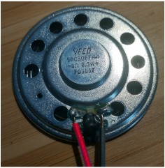

> 

*Table 1: NPN Transistor*

**NPN Transistor**

| **Solution**    | **Pros**      | **Cons**   |
| ------------ | ------------ | -------------- |
|  \*Option 1:   \* 2N3904(from class)  \* $0.29 for qty 1   [link to digikey](https://www.digikey.com/en/products/detail/onsemi/2N3904BU/1413)   [link to datasheet](https://www.onsemi.com/download/data-sheet/pdf/2n3903-d.pdf)| \* Inexpensive  \*  Meets PCB mount constraints  \* Used in provided speaker circuit, therefore compatible with PIC | \* Requires external components and support circuitry  \* Lower current capacity compared to other alternatives  \* 200 mA limit|
|  \* Option 2:  \* 2N4401BU  \* $0.28 for qty 1   [Link to digikey](https://www.digikey.com/en/products/detail/onsemi/2N4401BU/1417)   [link to datasheet](https://www.onsemi.com/pdf/datasheet/mmbt4401-d.pdf)| \* Inexpensive  \* High current limit of 600 mA   \* Meets PCB mount constraints |   \* Requires external components and support circuitry  | 
|  \* Option 3:  \* PN222AFS-ND  \* $0.32 for qty 1  [Link to digikey](https://www.digikey.com/en/products/detail/onsemi/PN2222ABU/6534)   [link to datasheet](https://www.onsemi.com/pdf/datasheet/pn2222a-d.pdf)| \* Meets PCB mount constraints  \* High current limit of 1A  | * More expensive  \* Requires external components and support circuitry |

**Choice:** Option 1:  2N3904

**Rationale: The part was already tested, used and was successful with the PIC as well in a previous lab for the class. It is inexpensive, and easy to solder.** 

  *Table 2: PNP Transistor*

**PNP Transistor**

| **Solution**    | **Pros**      | **Cons**   |
| ------------ | ------------ | -------------- |
|  \*Option 1:   \* 2N3906(from class)  \* $0.28 for qty 1   [link to digikey](https://www.digikey.com/en/products/detail/onsemi/2N3906BU/1414)   [link to datasheet](https://www.onsemi.com/download/data-sheet/pdf/2n3906-d.pdf)| \* Inexpensive  \*  Meets PCB mount constraints  \* Used in provided speaker circuit, therefore compatible with PIC | \* Requires external components and support circuitry  \* Lower current capacity compared to other alternatives  \* 200 mA limit|
|  \* Option 2:  \* 2N4403  \* $0.31 for qty 1   [Link to digikey](https://www.digikey.com/en/products/detail/on-semiconductor/2N4403BU/1418)   [link to datasheet](https://www.onsemi.com/pdf/datasheet/2n4403t.pdf)| \* Inexpensive   \* Meets PCB mount constraints |   \* 625 mW power max  \* Requires external components and support circuitry | 
|  \* Option 3:  \* PN2907ABU  \* $0.33 for qty 1  [Link to digikey](https://www.digikey.com/en/products/detail/onsemi/PN2907ABU/6538)   [link to datasheet](https://www.onsemi.com/pdf/datasheet/pzt2907a-d.pdf)| \* Meets PCB mount constraints | * More expensive  \* Requires external components and support circuitry |

**Choice:** Option 1: 2N3906

**Rationale:The part was already tested, used and was successful with the PIC as well in a previous lab for the class. It is inexpensive, and easy to solder.**    

*Table 3: Speaker*

**Speaker**

| **Solution**    | **Pros**      | **Cons**   |
| ------------ | ------------ | -------------- |
|  \*Option 1:   \* VECO 50CS08FH-1(from class)  \* TBD for qty 1  \* link to digikey not available  \* link to datasheet not available| \* Inexpensive  \* Used in provided speaker circuit, therefore compatible with PIC  \* Used in provided speaker circuit, therefore compatible with PIC   \* 8 ohm impedance | \* Requires external components and support circuitry  \* Limited output of sound  \* No price  \* No datasheet|
|  \* Option 2:  \* D0050008NM14BAR  \* $9.87 for qty 1   [Link to digikey](https://www.digikey.com/en/products/detail/stetron/D0050008NM14BAR/22155810)   [link to datasheet](https://www.stetron.com/wp-content/uploads/2024/01/DB04-050-Rev2.4-D0050008NM14BARJune-23-2020.pdf)| \* Similar size to option 1  \* 8 ohm impedance   \* Meets PCB mount constraints |   \* Requires external components and support circuitry  \* Solder required for connecting wires to the component  \* Expensive| 
|  \* Option 3:  \* 20660  \* $3.12 for qty 1  [Link to digikey](https://www.digikey.com/en/products/detail/sparkfun-electronics/20660/16688097)   [link to datasheet](https://cdn.sparkfun.com/assets/3/8/1/5/4/cvs-1508.pdf)| \* Inexpensive  \* Small in size    \* 8 ohm impedance  | * Limited sound output  \* Requires external components and support circuitry  \* Different mounting from option 1 and 2  \* PCB mounting is required|

**Choice:** Option 1: VECO 50CS08FH-1(from class)

**Rationale:The part was already tested, used and was successful with the PIC as well in a previous lab for the class. The part was also easy to solder.** 

*Table 4: 5V Regulator*

**5V Regulator**

| **Solution**    | **Pros**      | **Cons**   |
| ------------ | ------------ | -------------- |
|  \*Option 1:   \* LM7805(from class)  \* $1.53 for qty 1   [link to digikey](https://www.digikey.com/en/products/detail/stmicroelectronics/L7805ABV-DG/3945936)   [link to datasheet](https://www.st.com/content/ccc/resource/technical/document/datasheet/41/4f/b3/b0/12/d4/47/88/CD00000444.pdf/files/CD00000444.pdf/jcr:content/translations/en.CD00000444.pdf)| \* Inexpensive  \*  Meets PCB mount constraints  \* Fixed 5V output  \* Current output 1.5A  \* Input voltage max 35V  \* Easy to solder | \* Requires external components and support circuitry  \* High input voltage needed|
|  \* Option 2:  \* LM2940T-5.0/NOPB  \* $2.22 for qty 1   [Link to digikey](https://www.digikey.com/en/products/detail/texas-instruments/LM2940T-5-0-NOPB/148142)   [link to datasheet](https://www.ti.com/lit/ds/symlink/lm2940-n.pdf?HQS=dis-dk-null-digikeymode-dsf-pf-null-wwe&ts=1792167838898&ref_url=https%253A%252F%252Fwww.ti.com%252Fgeneral%252Fdocs%252Fsuppproductinfo.tsp%253FdistId%253D10%2526gotoUrl%253Dhttps%253A%252F%252Fwww.ti.com%252Flit%252Fgpn%252Flm2940-n)| \* Fixed 5V output   \* Easy to solder   \* Meets PCB mount constraints  \* Built in protection|   \* Requires external components and support circuitry  \* Input voltage max 26V   \* Current output 1A  \* Expensive | 
|  \* Option 3:  \* MC7805ACTG  \* $1.07 for qty 1  [Link to digikey](https://www.digikey.com/en/products/detail/onsemi/MC7805ACTG/1481210)   [link to datasheet](https://www.onsemi.com/pdf/datasheet/mc7800-d.pdf)| \* Meets PCB mount constraints  \* Inexpensive  \* Easy to solder| * Current output 1A  \* Requires external components and support circuitry |

**Choice:** Option 1:  LM7805

**Rationale:The part was already tested, used and was successful with the PIC as well in a previous lab for the class. The part was also easy to solder.** 

*Table 5:  9V Power Source*

**9V Power Source**

| **Solution**    | **Pros**      | **Cons**   |
| ------------ | ------------ | -------------- |
|  \*Option 1:   \*Model: 0930(from class)  \* TBD for qty 1   link to digikey not available  \* link to datasheet not available| \* Provides 9V DC  \* Current capacity 3A  \* No batteries needed| \* Requires outlet
 \* Not portable  \* Requires barrel jack that will work with this part |
|  \* Option 2:  \* SWH24-9-NB-P5  \* $19.54 for qty 1   [Link to digikey](https://www.digikey.com/en/products/detail/bel-power-solutions/SWH24-9-NB-P5/17736489?s=N4IgjCBcoCwBxVAYygMwIYBsDOBTANCAPZQDaIAzAAwCsMA7AgLqEAOALlCAMrsBOASwB2AcxABfQgFoYiECkgYcBEADchaLHkIlI5MFQCcAJhoUQLEBy4TpxuQv4BXFbvI0QhQxckgpANgcoZ1cySh9xcSA&utm)   [link to datasheet](https://www.belfuse.com/media/datasheets/products/power-supplies/SWH24-N.pdf)| \* Provides 9V DC  \* No batteries needed|   \* Current capacity 2A  \* Requires barrel jack that will work with this part   \* Requires outlet   \* Not portable | 
|  \* Option 3:  \* SWH24-12-NB-P5  \* $19.54 for qty 1  [Link to digikey](https://www.digikey.com/en/products/detail/bel-power-solutions/SWH24-12-NB-P5/17736479)   [link to datasheet](https://www.belfuse.com/media/datasheets/products/power-supplies/SWH24-N.pdf)| \* Provides 12V DC  \* No batteries needed | * Requires barrel jack that will work with this part  \* Requires outlet   \* Not portable |

**Choice:** Option 1: Model 0930

**Rationale: The part was successfully used in previous labs. Is compatible with the provided barrel jack and voltage regulator as well. It also provides the required 9V output.** 
