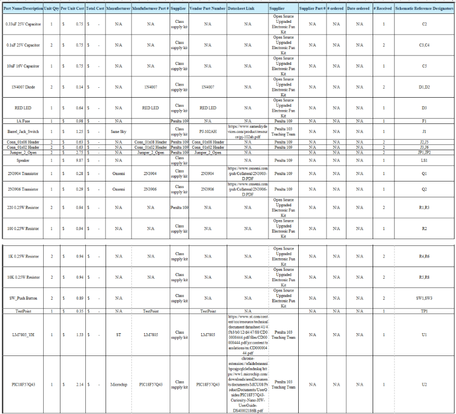

## Overview
Below is an image of the Bill of Materials of the components used for my subsystem. It lists everything that is on my schematic, and references the placement of each component to my schematic as well. 

## Bill of Materials Image
{style width: "2000"}
**Figure 2:** Example Bill of Materials as a screenshot.

As you can see, the text can be difficult to read without opening the image.
