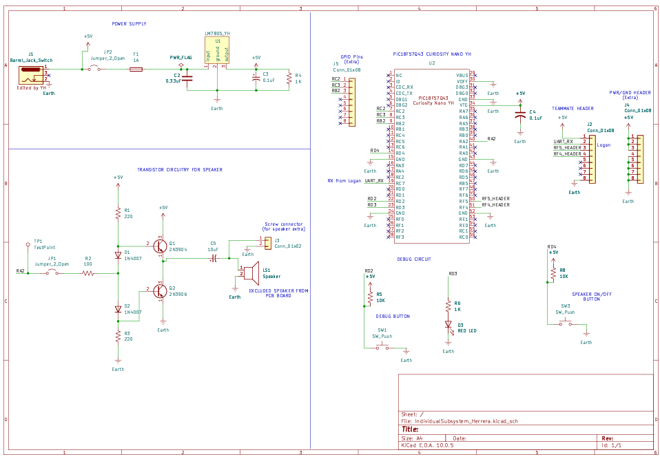

## Overview

This schematic is designed to support the overall function of our product by reacting to Logan Maeltsrom's .... (highlight functionally, power, and controller).

Schematic Image should be seen below:
  **Figure 1.0** Speaker transistor circuitry schematic
{style width:"350" height:"300;"}

## Resouces

The schematic as a PDF download is available [*here*](IndividualSubsystem_Herrera.pdf), and the Zip folder of the project [*here*](IndividualSubsystem_Herreraegr304.zip).
