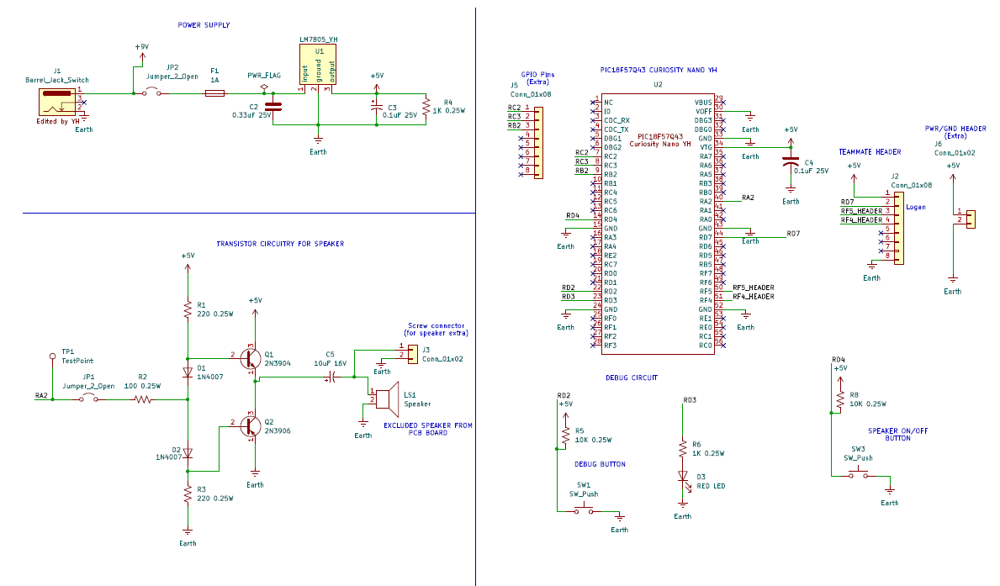

## Overview

This schematic is designed to support the overall function of our product by reacting to Logan Maeltsrom's board. My board will be a subsystem for triggering an audio alarm through a speaker to alert the driver. My power supply circuitry includes  5V regulator with a barrel jack that will be receiving a DC of 9V. I also have a speaker circuitry that includes transistors and header to allow the speaker to be removable. Lastly, I have a nano PIC board that will be receiving Logan's command as mentioned before. I included extra header pins for ground, power and GPIO pins for back up. I also included a debugging button and red LED, as well a speaker button to turn it on and off to fulfill the requirements. 

## Schematic Image should be seen below:
  **Figure 1.0** Speaker transistor circuitry schematic

## Resources

The schematic as a PDF download is available [*here*](IndividualSubsystemPDFRevised.pdf), and the Zip folder of the project [*here*](IndividualSubsystemHerreraNEW.zip).
