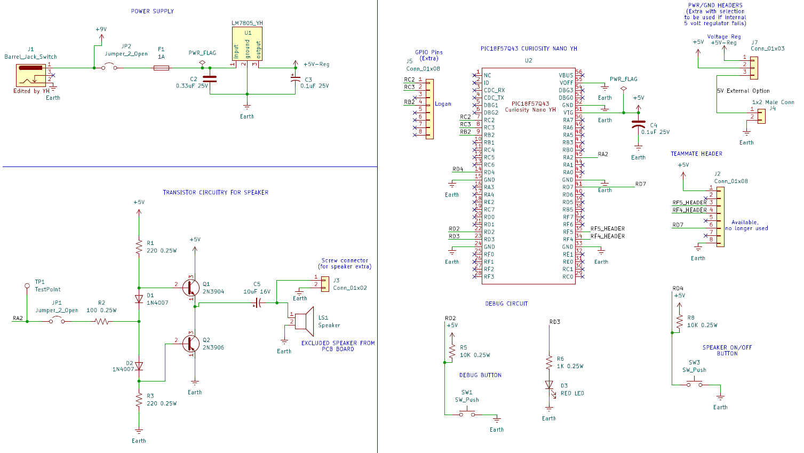

## Overview

This schematic is designed to support the overall function of our product by reacting to Logan Maeltsrom's board. My board will be a subsystem for triggering an audio alarm through a speaker to alert the driver. My power supply circuitry includes a 5V regulator with a barrel jack that will be receiving a DC of 9V. I also have a speaker circuitry that includes transistors and header to allow the speaker to be removable. Lastly, I have a nano PIC microcontroller that will be receiving Logan's command as mentioned before. I included extra header pins for ground, power and GPIO pins which ended up being needed. I am now connecting my board to Logan's board using the _GPIO Pins extra_ header, using a single jumper cable, no ribbon connectors. The _Team Header_ header will be now only be used for ground connection between the boards. I also included a debugging button and red LED, as well a speaker button to turn it on and off to fulfill the requirements. 

## Schematic Image should be seen below:
  **Figure 1.0** Speaker transistor circuitry schematic

## Resources

The schematic as a PDF download is available [*here*](IndividualHerreraJLC_Schematic.pdf).
