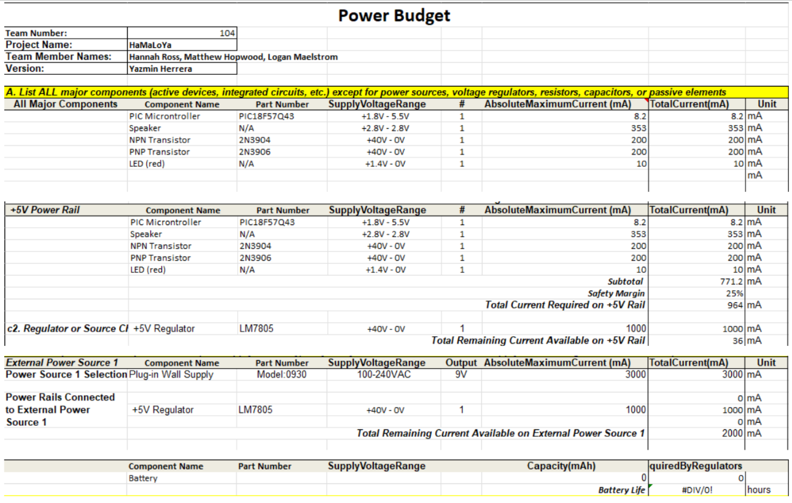

## Overview
A power budget was done  as it was very useful in allowing me to estimate the amount of power my subsystem needs to work. I started off my listing the major components used in my 
subsystem. I listed each components supply voltage and maximum current the component can consume. We were advised to add a 25% safety margin as a buffer to allow a bit more current capability
to the subsystem. 

 

## **Pin Table**

| PIC18F57Q43 Pin | Component | Function |
|---|---|---|
| RA2 | Transistor circuitry | DAC analog output |
| RD0 | Transistor circuitry | Digital output |
| RD1 | TBD connector | Digital signal |
| RD2 | Debug button 1 | Digital input |
| RD3 | Debug red LED | Digital output |
| RD4 | Speaker on/off button 2 | Digital input |
| RD5 | Logan's board connector | Digital signal |
| GND | Connector 1, pin 8 | Common ground |

 

 **Table 1.0 : Yazmin Herrera Subsystem Power Budget**  

## Conclusions

From the prepared Power Budget, I found that the total estimated current with the 25% safety margin, comes out to 964 mA. Therefore, I am within the range of an assumed
1000mA capacity for the 5V voltage regulator chosen for this subsystem. 

## Resources

The power budget as a PDF download is available [*here*](PowerBudgetHerrera.pdf), and a Microsoft Excel Sheet [*here*](PowerBudgetHerrera.xlsx).
