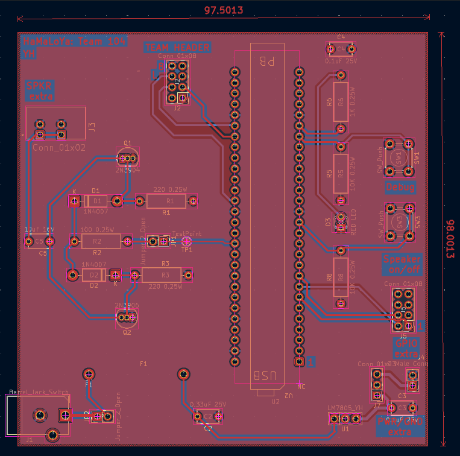
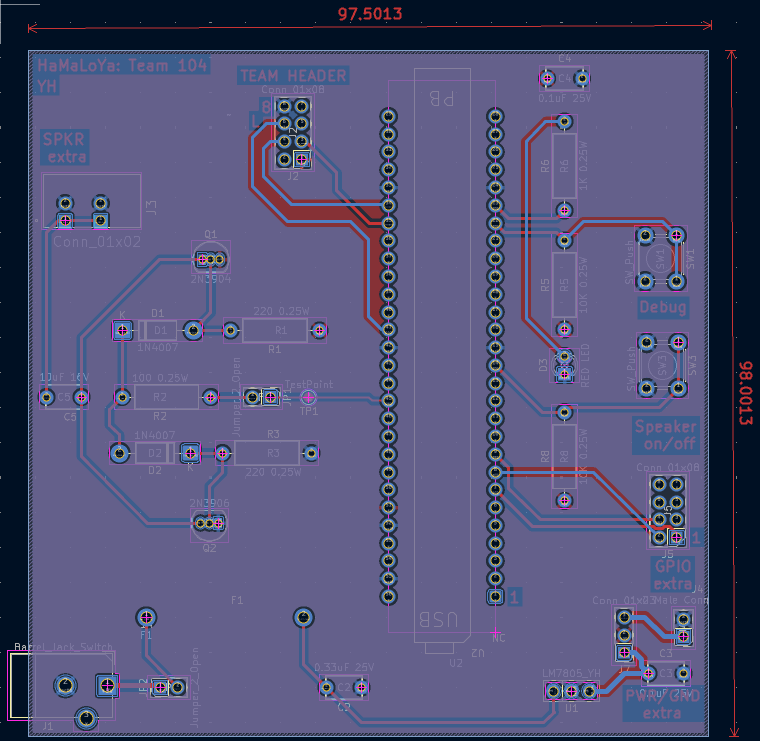

# PCB Design

## Overview 

Below I have added my PCB final design for my individual speaker subsystem. There were no changes made here.

## Figure 1.0 _Final PCB Front_

## Figure 1.1 _Final PCB Back_

## Figure 1.2 _Front layout of PCB_

## Figure 1.3 _Back layout of PCB_

## Resources

The PCB layout as a PDF download is available [*here*](UPDATEDPCBPDF.pdf), the zip file to the ECAD project [*here*](UPDATEDECADzip.zip), and the zip file to to the Gerber files [*here*](UPDATEDJLCGerberIndividual.zip).
