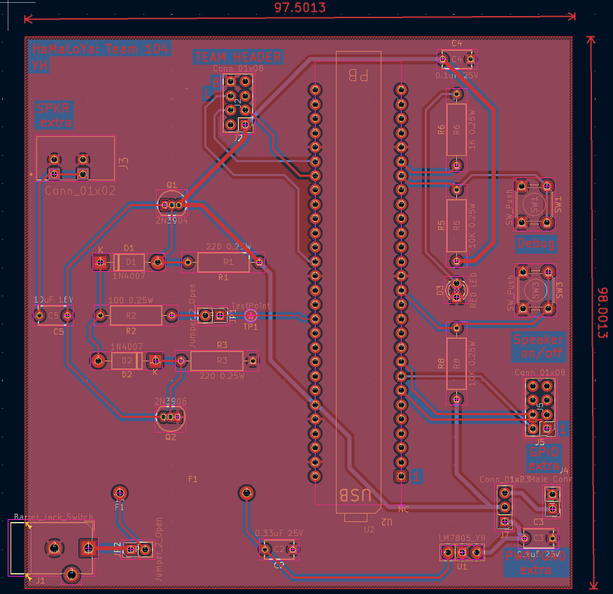
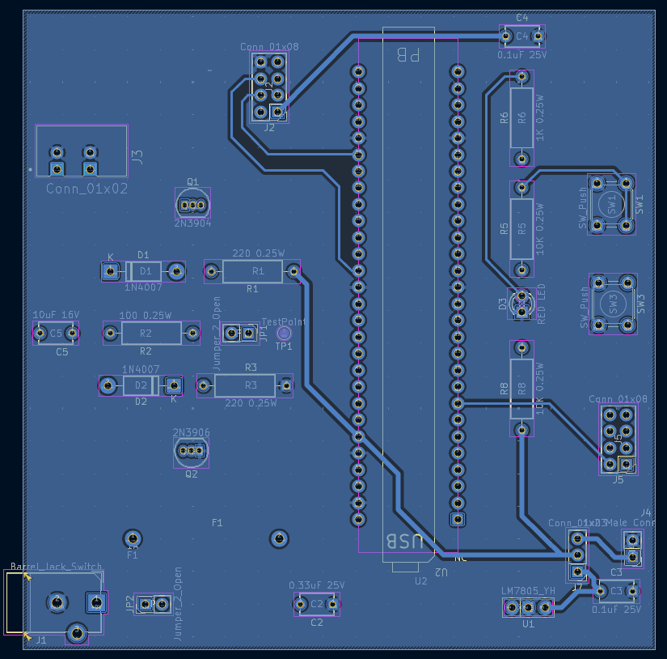

# PCB Design

## Overview 

Below I have added my PCB final design for my individual speaker subsystem 

## Figure 1.0 Front layout of PCB

## Figure 1.2 Back layout of PCB

## Resources

The PCB layout as a PDF download is available [*here*](IndividualSubsystem_Herrera.pdf), the zip file to the ECAD project [*here*](.zip), and the zip file to to the Gerber files [here](.zip).
