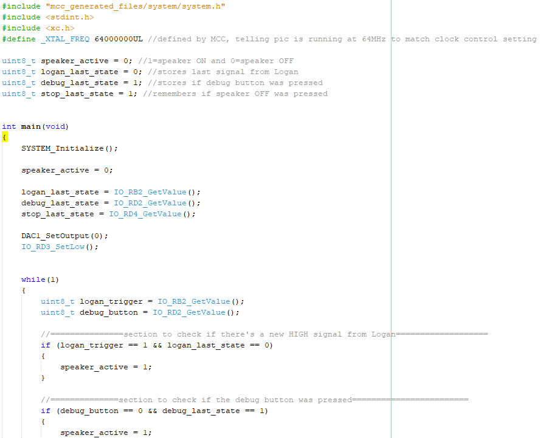
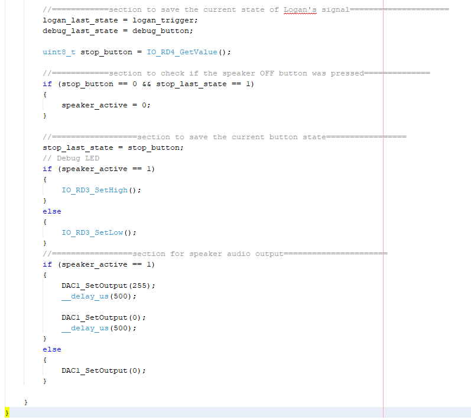

## Overview
My code for this speaker subsystem is shown below. I am using a PIC18F57Q43 curiosity Nano microntroller for the speaker subsystem. The microntroller will be receiving a digital signal from Logan's board that will trigger the speaker to alert the user. There is a button that will be used for the user to manually turn off the speaker once it's been activated.

 

## Code

 

 

## MPLAB X Files
The files to the code is available [*here*](inserthere)
